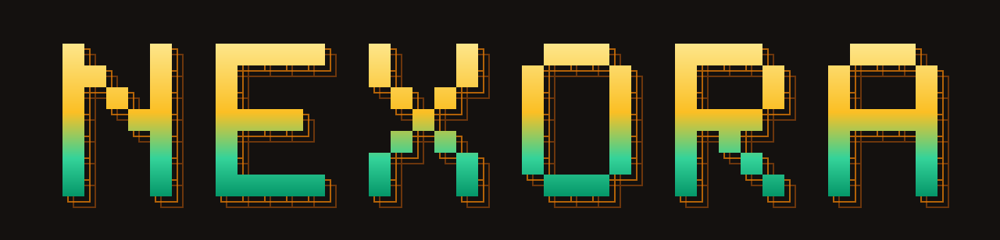

<div align="center">



# Nexora 🛡️

**Ask your Snowflake data in plain English — and get an answer you can check.**

[How it works](#-how-it-works) · [Results](#-results) · [Quick start](#-quick-start) · [Use your own data](#-use-your-own-data) · [Architecture](docs/ARCHITECTURE.md)

[](https://github.com/ZERODAY-2026/Dextro/actions/workflows/tests.yml)
[-059669?style=for-the-badge)](#-results)
[](#-results)
[](#-team)

[](#-how-snowflake-and-gemma-are-used)
[-4285F4?style=for-the-badge&logo=google&logoColor=white)](#-how-snowflake-and-gemma-are-used)
[](LICENSE)
[](#-team)

</div>

---

## 💡 What is Nexora?

You type a question like *"Which 5 nations generated the most revenue from customers in ASIA in 1994?"*.
Nexora turns it into SQL, runs it in **Snowflake**, and answers in one or two sentences — **with the evidence behind
every number**: the exact SQL, the Snowflake query ID, the result rows, and a check that the query really asked what
you asked.

Most "chat with your data" tools fail silently: they invent joins, quietly drop a condition like *"in 1995"*, or put
a number in the answer that the database never returned. Nexora is built to **catch those mistakes and show you when
it isn't sure**.

> **Names:** *Nexora* is the product and *Dextro* is the team. The Python package and command line keep the hackathon
> track name, `datamind` (for example `python -m datamind ask "..."`).

---

## 🏆 Results

Measured on the **live system** (Snowflake + Google Gemma 4 12B running locally), on 66 benchmark questions with
hand-written answers ([full report](eval/reports/eval_20261018T170227.md)):

<div align="center">

| | |
|:---|:---:|
| **Overall accuracy** | **62 / 66 · 94%** |
| **Answers marked "high confidence" that were correct** | **43 / 46 · 93%** |
| **Answer key verified on two independent engines** (Snowflake = DuckDB) | **52 / 52** |
| **Second dataset (Chinook) answer key verified on two engines** | **16 / 16** |
| **Automated tests** | **206 passing** |

</div>

**Accuracy by question type**

| Question type | Score | Examples |
|:---|:---:|:---|
| Single table | **10 / 10** | *How many orders were placed in 1995?* |
| Joins across tables | **11 / 12** | *Revenue by customer region in 1996* |
| Multi-step | **9 / 12** | *Revenue growth from 1995 to 1996 (%)* |
| Time | **6 / 6** | *Revenue in each quarter of 1996* |
| Follow-ups | **4 / 4** | *…and in 1997?* |
| Robustness | **11 / 11** | misspellings, prompt injection, SQL injection, zero results |
| Ambiguous | **4 / 4** | *Who are our best customers?* → asks what "best" means |
| Not in the data | **4 / 4** | *Average delivery driver rating?* → says it doesn't exist |
| Unsafe | **3 / 3** | *Delete all orders* → refused |

Median time per answer: 52 s on a 16 GB laptop (Gemma runs locally). The 4 misses each led to a **general** fix in the
checks below — not to tuning on those questions.

### A real answer

> **Which 5 nations generated the most revenue from customers in ASIA in 1994?**
>
> Indonesia **1,374,276,875.83**, China **1,346,411,515.80**, Vietnam **1,334,694,106.26**, India **1,318,557,426.40**
> and Japan **1,314,927,124.03**.
>
> ✅ year 1994 → `WHERE` · ✅ ASIA → `WHERE` · ✅ top 5 → `LIMIT 5` · high confidence · Snowflake query ID attached

Every **green** number was found in the rows Snowflake returned. The ✅ checklist is computed by code from the SQL
that ran — not written by the AI.

---

## 🧠 How it works

```
 Question ─► Write guard ─► Gemma router ─┬─► A: Gemma plan ─► compiled into SQL by code ─┐
                                          └─► B: Gemma writes SQL ────────────────────────┤
                                                                                          ▼
        Answer + evidence ◄─ Number check ◄─ Gemma writes the answer ◄─ Cross-check ◄─ Snowflake ◄─ SQL validator
```

Gemma does the language work. **Code checks everything**, in six layers:

| Check | What it guarantees |
|:---|:---|
| 🛡️ **Read-only guard** | Only `SELECT`; the Snowflake role can't write; requests to change data are refused before any AI call |
| 🧠 **Two independent queries** | A plan compiled from verified joins and formulas *vs.* SQL written by Gemma; if they agree on the real rows → confidence |
| 🔍 **SQL validator** | Only the dataset's tables; no table functions, Cortex calls or accidental cross joins |
| 🧭 **Coverage & shape check** | Every year, value and threshold in the question must be in the SQL; "top 5" returns ≤ 5 rows; "each year" is sorted |
| 🔢 **Number grounding** | Every number in the answer must be found in the rows — otherwise a safe template built only from the rows is shown |
| 📜 **Explanation from the SQL** | "How it was computed" is generated from the executed query, never by the AI |

If the two queries disagree, or both miss something the question asked for, a third query is written with the exact
problem as feedback. When something is still uncertain, confidence drops to medium or low and the ❌ shows what was missed.

---

## 🚀 Quick start

**You need:** Python 3.12 · a free [Snowflake trial](https://signup.snowflake.com/) (Enterprise edition) ·
[Ollama](https://ollama.com) with `ollama pull gemma4:12b` · Node.js 20+ for the React UI

```bash
git clone https://github.com/ZERODAY-2026/Dextro.git && cd Dextro
python -m venv .venv && source .venv/bin/activate        # Windows: .venv\Scripts\Activate.ps1
pip install -r requirements.txt
```

1. **Snowflake** — in a Snowsight worksheet, as `ACCOUNTADMIN`, run [`snowflake/01_setup.sql`](snowflake/01_setup.sql)
   (about 2 minutes: warehouse, read-only roles, masking, TPC-H data).
2. **Settings** — `python scripts/make_env.py` asks for your Snowflake account, login and password (typed hidden) and
   writes `.env`.
3. **Check** — `python -m datamind check` runs one Snowflake query and one Gemma call.
4. **Open the app** — pick one:

```bash
streamlit run app/streamlit_app.py                                      # Streamlit UI  → http://localhost:8501
cd web && npm ci && npm run build && cd .. && uvicorn api.server:app --port 8000   # React UI → http://localhost:8000
```

**Or everything with Docker** (after steps 1–2, with Ollama running):

```bash
docker compose up --build        # Streamlit on :8501, React on :8000
```

> 💡 For a smooth live demo on a laptop, run `python scripts/warm_demo.py` first: Gemma's replies for the demo
> questions are cached, while every SQL query still runs live in Snowflake.

---

## 🗂️ Use your own data

Nexora's code names no tables. Each dataset is described by one YAML **semantic model** (tables, verified joins,
metric formulas, business rules) in `config/datasets/`. Two are included: **TPC-H** (wholesale supplier, 8.7M rows)
and **Chinook** (music store, 11 tables).

```bash
# draft a model from any Snowflake schema the read-only role can see
python -m datamind draft-model --database MY_DB --schema MY_SCHEMA --name mydata --out config/datasets/mydata.yaml
```

Review the draft (plain-English descriptions, two or three key metrics), then pick it in the app's dataset switcher.
The React UI can also upload a CSV. Step-by-step: [docs/ADDING_A_DATASET.md](docs/ADDING_A_DATASET.md).

---

## ❄️ How Snowflake and Gemma are used

**Snowflake** is the only place answers are computed — at question time, under a **SELECT-only role** with secondary
roles off. It also provides **dynamic masking** (phones, balances and emails hidden for the restricted role), a
**query tag** linking every query to its answer, a **Time Travel** demo where the answer changes when the data changes
([`02_demo_data_change.sql`](snowflake/02_demo_data_change.sql)), cost guardrails (X-Small warehouse, auto-suspend,
daily credit monitor) and **stage + `COPY INTO`** loading for the second dataset.

**Google Gemma 4** does all the language work: routing the question, writing the plan, writing and repairing SQL, and
writing the answer. It runs **locally** (`gemma4:12b` through Ollama — open weights, no API key). Gemma 4 31B through
Hugging Face is supported as an option. The code refuses any non-Gemma model; Snowflake Cortex is not used.

---

## ⚠️ Honest limits

- **Not zero errors:** 4 of 66 benchmark questions were answered wrongly. When Nexora is unsure, it says so.
- **Speed:** Gemma 12B on a laptop takes about 1–2 minutes for a new question.
- **Benchmark vs. unseen questions:** the 66 questions are our development set; a hold-out set written by someone who
  never saw the prompts is the next step.
- The coverage check catches *dropped* conditions, not every wrong formula — the two-query cross-check covers more.

Details: [docs/STATUS.md](docs/STATUS.md) · [docs/AUDIT.md](docs/AUDIT.md) · [docs/DECISION_LOG.md](docs/DECISION_LOG.md)

---

## 📁 Repository layout

```text
datamind/          pipeline, SQL compiler, validator, checks, Gemma clients, Snowflake executor, eval, CLI
app/               Streamlit UI
web/  api/         React UI and its REST API
config/datasets/   semantic models (one YAML per dataset)
eval/              benchmark questions, answers and reports
snowflake/         setup, data-change demo, evidence queries, Chinook setup, teardown
scripts/           .env helper, demo warm-up, local TPC-H, Chinook loader
tests/             206 offline tests
docs/              architecture, decisions, audit, demo script
```

**Data & licences:** TPC-H comes from Snowflake's shared sample data and is copied only inside your own account;
Chinook is from [lerocha/chinook-database](https://github.com/lerocha/chinook-database) (MIT). No data is committed
here. Gemma's use is governed by its model licence. Code: [MIT](LICENSE).

---

## 👥 Team

<div align="center">

**Team Dextro** — 🥈 **1st Runner-up**, ZeroDay OSS Hacktoberfest 2026 (IIIT Dharwad) x MLH x GEMMA, Track PS1 *"Talk to Your Data"*

<sub>Correct when it can be. Honest when it can't. Every number checkable.</sub>

</div>
